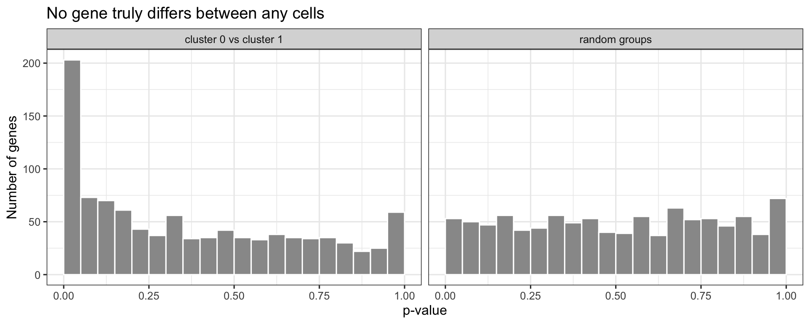
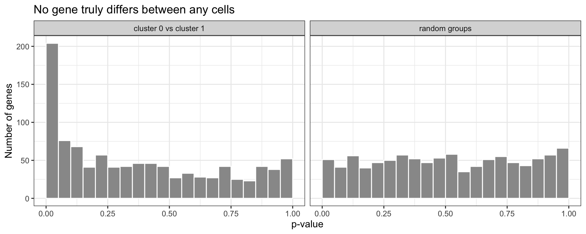
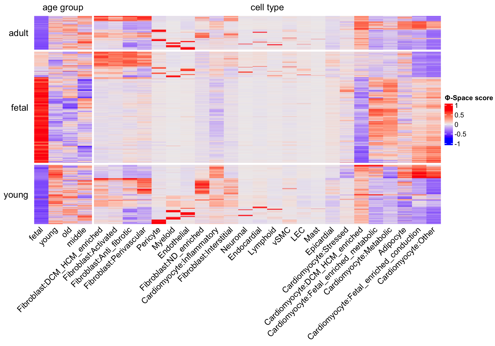
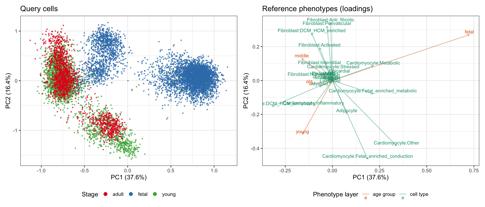
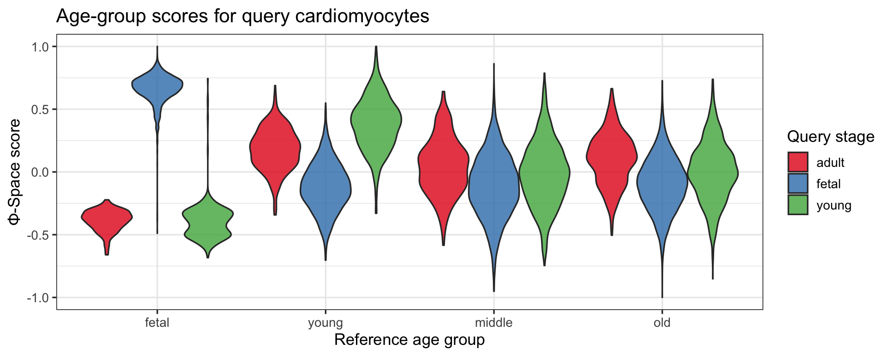

## How this module runs {.smaller}

::: {.callout-tip}
## Open in RStudio
`vignettes/01_phispace_annotation.Rmd`

The rendered page is on the [workshop website](https://mao-lab-org.github.io/scWorkshop/01_phispace_annotation.html).
:::


# Why not discrete labels?

## Two assumptions behind cluster labels

The usual workflow: **cluster → marker genes → one label per cluster**.

It assumes:

::: {.incremental}
1. **Each cell belongs to one cell type.** Every cell in a cluster
   inherits the cluster's label.
2. **Cell identity is discrete.** No cell is *partly* foetal and *partly*
   adult.
:::

. . .

Our data span **foetal, young and adult** hearts. Cardiomyocytes mature
gradually.


## A second problem: double-dipping {.smaller}

Simulate 1,000 cells from **one** population: no 'subtypes'.

{fig-align="center" height="340"}

::: {.columns}
::: {.column width="60%"}
::: {.incremental}
- One round data cloud, but clustering still cuts it roughly
  in two.
- Random groups (resulting from a random split).
:::
:::

::: {.column width="40%"}
::: {.callout-note}
## In RStudio
Run chunk `double-dipping`.
:::
:::
:::


## Phantom markers {.smaller}


{.r-stretch}

::: {.columns}
::: {.column width="60%"}
::: {.incremental}
- **Random split:** p-values spread evenly.
- **Two clusters:** about 4× as many genes with p < 0.05.
- How should we read this? Cautious about 'fine cell types'.
:::
:::

::: {.column width="40%"}
::: {.callout-note}
## In RStudio
Run chunk `double-dipping-test`.
:::
:::
:::


# Φ-Space {background-color="black" background-image="figs/methods/PhiSpaceST_cover_art_preview.jpg" background-size="contain" background-position="right"}

From labels to scores


## A different question {.smaller}

::: {.columns}
::: {.column width="50%"}
Reference-based cell annotation asks:

> **How much does this cell resemble each reference phenotype?**


- One score per **cell × phenotype**
- Several phenotype layers at once: cell type **and** age group
- Collapse to a label with `getLabels()` when needed
:::

::: {.column width="50%"}
::: {.fragment}
Toy example (values are illustrative):

| cell | fetal | young | CM | Fib. |
|---|---:|---:|---:|---:|
| A | **0.72** | −0.31 | **0.81** | −0.24 |
| B | 0.35 | **0.38** | **0.66** | −0.18 |
| C | −0.41 | 0.12 | 0.04 | **0.70** |

Cell B is **between** foetal and young: a hard label would hide that.
:::
:::
:::


## How Φ-Space works

```{mermaid}
%%| fig-width: 11
flowchart LR
  R["Reference<br/>expression X<br/>+ labels"] --> Y["Dummy matrix Y<br/>(one column per phenotype)"]
  Y --> P["PLS regression<br/>X → Y"]
  R --> P
  Q["Query<br/>expression"] --> S
  P --> S["Φ-Space scores<br/>cells × phenotypes"]
  S --> L["getLabels()<br/>one label per cell"]
  S --> D["Downstream:<br/>Modules 2 and 3"]
```

. . .

The reference and the query are **different data**, so the annotation
does not double-dip.

::: aside
Mao, Deng & Lê Cao 2025, *Genome Biology*
:::


## Our reference: Gao et al. 2026 heart atlas {.smaller}

::: {.incremental}
- Left-ventricle snRNA-seq, foetal to ≥ 60 years
- **6,096** reference cells, **13** cell types, **4** age groups
  (`fetal`, `young`, `middle`, `old`)
- Cardiomyocytes and fibroblasts split into **subtypes**
  (`Fetal_enriched_metabolic`, `Stressed`, …)
- Subtypes with fewer than 20 cells dropped
:::

. . .

Result: **28** phenotype columns = 24 cell types + 4 age groups.

::: {.callout-note}
## Exercise 1 (discussion)
Could a whole-*cell* reference annotate our *nuclei*? What could go
wrong?
:::


# Hands-on: run Φ-Space

## Three preparation steps

::: {.incremental}
1. **Match normalisation:** scran on the query, like the reference
   (`scranTransf()`)
2. **Keep common genes:** 15,094 genes in both datasets
3. **Remove all-zero genes:** `zeroFeatQC()`
:::

::: {.callout-note}
## In RStudio
Run from `load-data` to `common-genes`.
:::

## One function call

```{.r code-line-numbers="|2-3|4|5|6-9|10"}
query <- PhiSpace(
    reference         = reference,
    query             = query,
    phenotypes        = c("cell_type_fine", "age_group"),
    refAssay          = "logcounts",
    regMethod         = "PLS",
    center            = TRUE,
    scale             = FALSE,
    cellTypeThreshold = 20
)
```

::: {.fragment}
Scores in `reducedDim(query, "PhiSpace")`: **10,000 cells × 28
phenotypes**.
:::


# What the scores show

## Scores recover the donor stage {.smaller}

{.r-stretch}


## The phenotype space in two dimensions

{.r-stretch}

::: {.fragment}
Most foetal cells (left) sit at high PC1, where the `fetal` arrow
(right) points.
:::


## Scores collapse to labels

`getLabels()` picks the highest score. Donor stage (rows) vs. best
reference age group (columns):

| donor stage | fetal | young | middle | old |
|---|---:|---:|---:|---:|
| fetal | [4,304]{.fragment .highlight-blue} | 236 | 518 | 391 |
| young | 16 | [1,370]{.fragment .highlight-blue} | 797 | 716 |
| adult | [0]{.fragment .highlight-red} | [374]{.fragment .highlight-red} | [717]{.fragment .highlight-red} | [561]{.fragment .highlight-red} |

. . .

Foetal cells are clearly foetal. Post-natal cells **spread** over the
post-natal age groups.


## Cardiomyocytes vary within a stage

{.r-stretch}

. . .

Each donor stage covers a **range** of scores. 


# Wrap-up

## Optional exercises

::: {.columns}
::: {.column}
::: {.callout-note}
## Exercise 2: normalisation
Run Φ-Space with library-size normalisation, raw counts, and ranks.
Which mismatch matters?
:::
:::

::: {.column}
::: {.callout-note}
## Exercise 3: fewer features
Run with `nfeat = 100`. Which scores change? Do the adult
cardiomyocytes move to a different age group?
:::
:::
:::


## Recap

::: {.incremental}
- Φ-Space gives each cell a **score for every reference phenotype**.
- Reference and query are different data: **no double-dipping**.
- Scores can always become labels (`getLabels()`).
- Module 1 saves the annotated query for Module 2:
  `results/05_phispace_query.rds`.
:::

. . .

**Next, Module 2:** order the cardiomyocytes along maturation
(pseudotime). The `fetal` score tells us where maturation starts.
