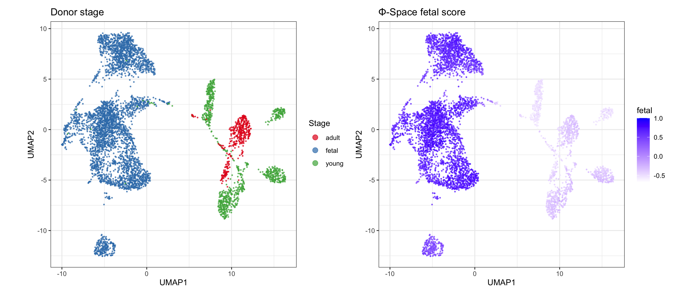
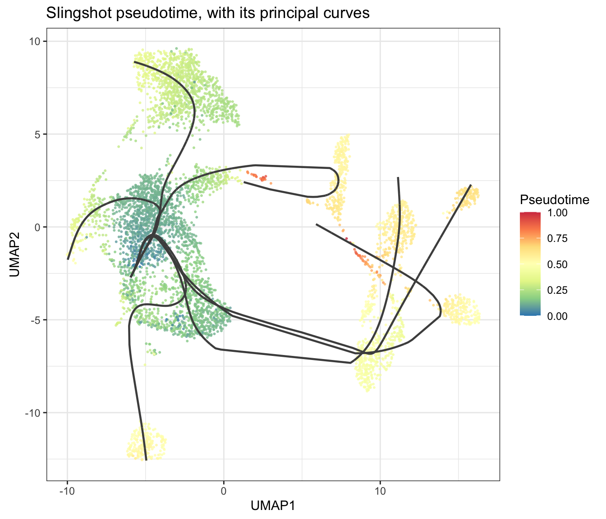
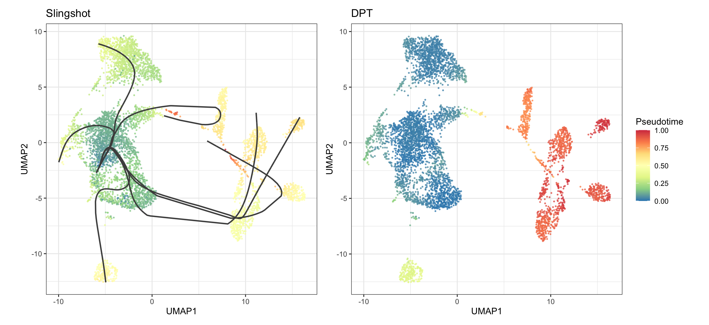
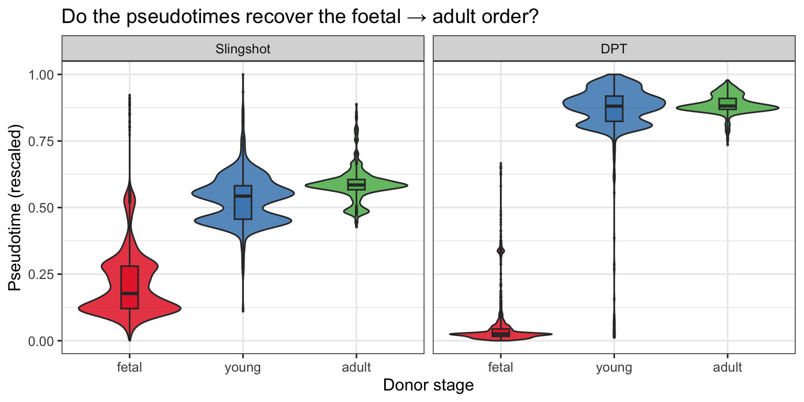
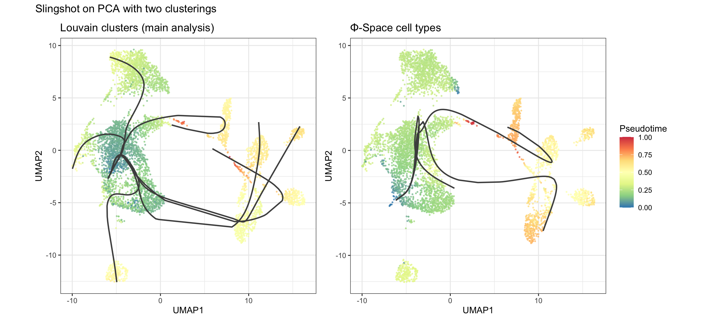
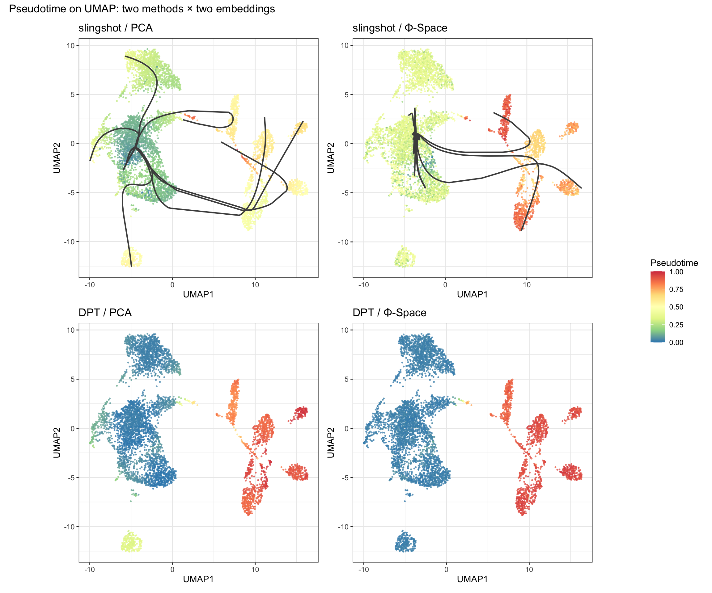

## How this module runs {.smaller}

::: {.callout-tip}
## Open in RStudio
`vignettes/02_pseudotime.Rmd`

The rendered page is on the [workshop website](https://mao-lab-org.github.io/scWorkshop/02_pseudotime.html).
:::


# What is pseudotime?

## An ording

Cardiomyocytes from the same
donor can differ in how mature they are.

. . .

**Pseudotime** gives each cell one number for its position along a
process:

::: {.incremental}
- cells close together in the process get close values;
- the scale is arbitrary: **only the order matters**;
- what the process is is open to interpretation;
- which end is 'early' is a tuning parameter.
:::

## 

::: {.columns}
::: {.column width="50%"}
### Slingshot

1. Cluster the cells
2. Link cluster centres into a tree from a **starting cluster**
3. Fit smooth **principal curves**
4. Pseudotime = distance along the curve
:::

::: {.column width="50%"}
### Diffusion pseudotime (DPT)

1. Build a graph of similar cells
2. Diffuse from a **root cell**
3. Pseudotime = diffusion distance from the root
4. No clusters needed
:::
:::

. . .

Both run on a **PCA of gene expression** (20 PCs). The UMAP is only for
plotting.


# Hands-on: from PCA to pseudotime

## The pipeline

```{mermaid}
%%| fig-width: 11
flowchart LR
  M["Module 1 output<br/>cardiomyocytes only<br/>(5,411 nuclei)"] --> P["PCA<br/>20 PCs"]
  P --> C["Louvain clusters<br/>(12)"]
  C --> S["Slingshot"]
  P --> D["DPT"]
  F["Φ-Space fetal score<br/>(Module 1)"] -. "start cluster" .-> S
  F -. "root cell" .-> D
  P --> U["UMAP<br/>(plotting only)"]
```

::: {.callout-note}
## In RStudio
Run from `load-module1` to `clusters`.
:::


## Where does maturation start?

{.r-stretch}

::: {.incremental}
- **Start cluster** (slingshot): the cluster with the highest mean `fetal`
  score.
- **Root cell** (DPT): the cell with the highest `fetal` score.
:::


## Two function calls

```{.r code-line-numbers="|1-6|3|4|5|7|9-11|11"}
sling <- slingshot(
    reducedDim(cm, "PCA"),
    clusterLabels = cm$cluster,
    start.clus    = start_cluster,
    dist.method   = "simple"
)
cm$pt_slingshot <- rowMeans(slingPseudotime(sling), na.rm = TRUE)

dm  <- DiffusionMap(as.matrix(reducedDim(cm, "PCA")),
                    n_eigs = 20, sigma = "local")
dpt <- DPT(dm, tips = root_cell)
```


## Slingshot finds a branching tree


{height="560"}

**7 lineages**? are they real?


# Do the two pseudotimes agree?

## Three checks for any pseudotime

There is no ground-truth ordering, and no method is best for every
dataset. (I mean you all know this but I have to repeat it.)

::: {.incremental}
1. Do they put the same cells early and late on one map?
2. Do they agree on the order? (Spearman, ranks only)
3. **Compare with held-out information:** donor stage, which neither
   method saw.
:::


##

{.r-stretch}

::: {.fragment}
Spearman ρ = **0.85** between slingshot and DPT: they agree quite well on the order.
:::

## Compare with donor stage

{.r-stretch}

::: {.incremental}
- Both put **foetal nuclei first**. Neither separates **young from
  adult** well.
- DPT is nearly **all-or-nothing**.
:::


## Recap

::: {.incremental}
- Pseudotime **orders** cells; it is not real time, and it needs a
  starting point.
- Slingshot and DPT on PCA agree (ρ = 0.85).
- Neither separates young from adult donors: maturity varies **within**
  an age group.
- With no ground truth, compare **several methods** with each other and
  with information they **did not use**.
:::

. . .

**Next, Module 3:** do gene **relationships** change along maturation?


# Optional extensions

## A: slingshot depends on the clustering {.smaller}

::: {.callout-note}
## Think first
Give slingshot the Φ-Space cell types (fewer, reference-defined) instead
of 12 Louvain clusters. How will the **number of branches** change? Will
the **agreement with donor stage** change as much?
:::

{.fragment height="320"}

::: {.fragment}
**3** lineages instead of 7, but ρ with stage barely moves (0.73 vs
0.72). One summary number can hide very different trajectories.
:::

## B: pseudotime from Φ-Space {.smaller}

::: {.columns}
::: {.column width="50%"}

:::

::: {.column width="50%"}
::: {.incremental}
- The **embedding** changes the order more than the method: same method,
  PCA vs Φ-Space, ρ = 0.62; slingshot vs DPT on PCA, ρ = 0.85.
- All five orderings agree with donor stage about equally
  (ρ = 0.72–0.75).
- The Φ-Space score (adult − fetal) agrees well with the PCA pseudotimes
  (ρ ≈ 0.8). **Module 3 uses this score.**
:::
:::
:::
