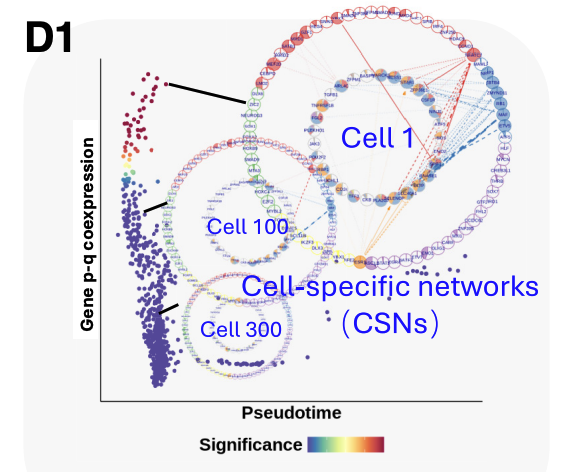
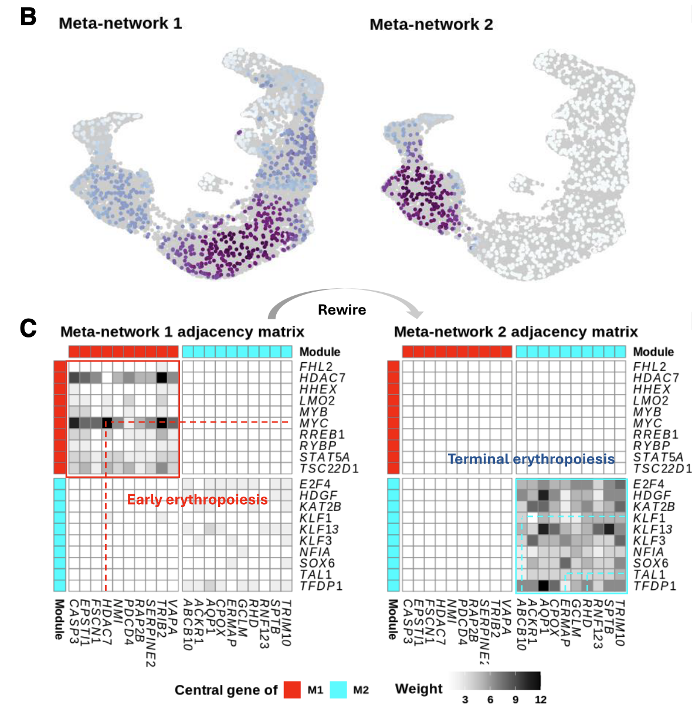
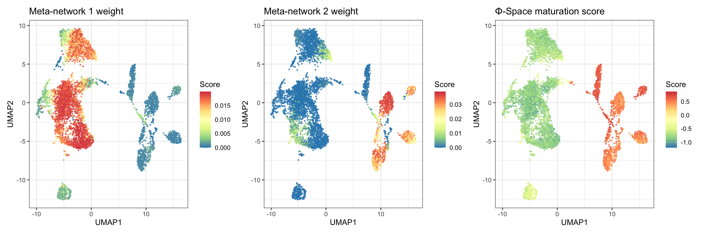
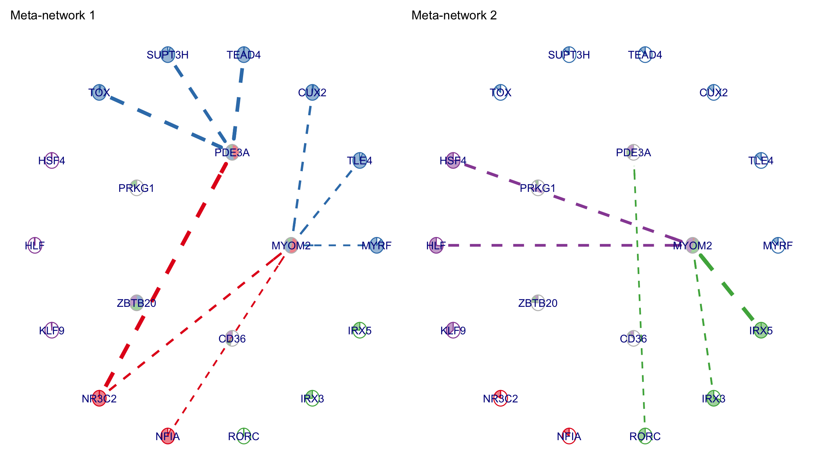
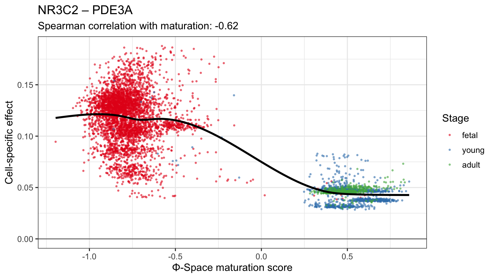

## How this module runs {.smaller}

::: {.callout-tip}
## Open in RStudio
`vignettes/03_nnet.Rmd`

The rendered page is on the [workshop website](https://mao-lab-org.github.io/scWorkshop/03_nnet.html).
:::

| Block | Time | Where |
|---|---|---|
| From gene levels to gene relationships | 10 min | slides |
| Choose genes, run NeighbourNet | 10 min | RStudio |
| Read the networks | 25 min | RStudio + slides |
| Recap and workshop wrap-up | 5 min | slides |

# NeighbourNet {background-color="#1b4f5c" background-image="figs/methods/NNet.png" background-size="contain" background-position="right"}

From gene levels to gene relationships

## The question

Modules 1 and 2 described **where** each cardiomyocyte is along
maturation.

. . .

Module 3 asks: as cardiomyocytes mature, do the **relationships between
genes** change?

. . .

::: {.callout-warning}
## Co-expression is not regulation
A gene regulatory network (GRN) claims that one factor *causes* changes
in another. Single-cell RNA-seq alone cannot show that. We build
**co-expression networks**: TFs and target genes that vary together.
The edges are hypotheses, not proof.
:::

## One network per cell

::: {.columns}
::: {.column width="45%"}
{fig-align="center"}
:::

::: {.column width="55%"}
::: {.incremental}
- For each cell, regress each target gene on the TFs **within the cell's
  neighbourhood** (its nearest neighbours).
- Result: a TF × target network **per cell**: `effect[target, TF, cell]`.
- Single-cell networks are noisy, so NeighbourNet also summarises them.
:::
:::
:::

::: aside
Deng, Mao, Choi & Lê Cao 2026, *Genome Research* 36:785–801
:::

## Meta-networks: recurring patterns

::: {.columns}
::: {.column width="50%"}
{height="500"}
:::

::: {.column width="50%"}
::: {.incremental}
- NeighbourNet combines the cell-specific networks into a few
  **meta-networks**: recurring co-expression patterns.
- Each cell gets a **weight** on each meta-network: how much its own
  network contributes.
- Meta-network 1 is the strongest pattern, meta-network 2 the next.
:::
:::
:::

::: {.notes}
Example from the NeighbourNet paper (erythropoiesis): B shows the cell
weights, C the adjacency matrices. The aggregation is a non-negative
PCA of the cell-specific networks.
:::

# Hands-on: choose genes, run NeighbourNet

## Focus on maturation {.smaller}

Maturation axis: the **Φ-Space score** = mean(young, middle, old) −
fetal, from Module 1. It needs no trajectory model and agrees with
Module 2's pseudotimes (ρ ≈ 0.8).

::: {.incremental}
- Rank genes by association with the score (`PhiSpace::rankFeatures()`);
  keep the **top 10**.
- NeighbourNet only models genes in its **target prior**: 5 of the 10
  survive (*PDE3A*, *MYOM2*, *PRKG1*, *CD36*, *ZBTB20*).
- Predictors: **875 TFs**.
:::

::: {.callout-note}
## Exercise 1
Do the 10 genes rise or fall with maturation? Which ones are missing from
the target prior?
:::

## The NeighbourNet pipeline

```{.r code-line-numbers="|2|3|4|5|6"}
seu <- seu |>
    prepare.seurat(genes = genes$genes, npcs = 50) |>
    prepare.graph(knn = 30) |>
    prepare.reg(predictors = genes$tfs, responses = genes$targets) |>
    run.nn.reg(responses = genes$targets, return.p.val = TRUE) |>
    build.meta.network(n.net = 2)
```

::: {.incremental}
- PCA on the selected genes, then a k-nearest-neighbour graph
- Per-cell regressions of targets on TFs
- Two meta-networks from the cell-specific networks
:::

::: {.callout-note}
## In RStudio
Run to `inspect-nnet`. The result is cached, so it loads in seconds.
:::

# What the networks show

## Meta-network weights track maturation

{.r-stretch}

::: {.fragment}
Meta-network 1 is the **foetal** pattern (ρ = −0.72 with the maturation
score); meta-network 2 the **post-natal** pattern (ρ = +0.62).
:::

## Two meta-networks, different TFs {.smaller}

::: {.columns}
::: {.column width="65%"}

:::

::: {.column width="35%"}
::: {.incremental}
- **1 (foetal):** NR3C2, TOX, TEAD4, SUPT3H → *PDE3A*; CUX2, TLE4,
  NR3C2, … → *MYOM2*
- **2 (post-natal):** IRX5, IRX3, HSF4, HLF → mostly *MYOM2*
- Every edge is **dashed**: no support from prior knowledge.
:::
:::
:::

## Explore interactively {.smaller}

::: {.columns}
::: {.column width="55%"}
`R/nnet_viz.R` draws the same networks with visNetwork:

```{.r}
source("../R/nnet_viz.R")
tabs <- nnet_tables(seu, i = 1, meta.network = TRUE,
                    radius = c(0.4, 0.7, 0.85, 1))
nnet_vis(tabs)
```

- **Diamonds** are TFs, **circles** are targets; colour = TF module.
- **Dashed** = co-expression only; solid with arrow or T-bar = prior
  support.
- Hover for numbers; click a gene to highlight its partners.
:::

::: {.column width="45%"}
::: {.callout-note}
## Exercise 2
1. Which target is the hub of meta-network 1?
2. ZBTB20 has no edge drawn but a confident edge. Why?
3. Do the two meta-networks use different TF modules?
4. How many edges have prior support?
:::
:::
:::

## Does an edge change as cells mature?

{.r-stretch}

::: {.fragment}
NR3C2–*PDE3A*, the strongest edge of meta-network 1, is strong in
foetal-like cells and weak after birth (ρ = −0.62).
:::

::: {.notes}
Exercise 4: TOX–PDE3A is negative in foetal-like cells and close to zero
after birth; IRX5–MYOM2 grows stronger with maturation. Meta-networks
group edges by the size of their effect, not its sign.
:::

## Single cells are noisy {.smaller}

::: {.callout-note}
## Exercise 3
Compare the networks of the **most foetal-like** and the **most
adult-like** cell (lowest and highest maturation score).
:::

. . .

| cell | donor | edges above the cutoff |
|---|---|---|
| most foetal-like | foetal | TOX → *PDE3A* |
| most adult-like | [young]{.fragment .highlight-red} | KLF9 → *PDE3A*, HSF4 → *MYOM2*, KLF9 → *ZBTB20* |

. . .

- Each cell looks like one meta-network, with only a few edges.
- The most adult-like cell is from a **young** donor: maturity varies
  within an age group, as in Module 2.

# Wrap-up

## Optional exercises

::: {.columns}
::: {.column}
::: {.callout-note}
## Exercise 5: edge cutoff
Redraw meta-network 1 with `cutoff = 0.5` and `0.99`. Which edges
survive?
:::
:::

::: {.column}
::: {.callout-note}
## Exercise 6: more target genes
Re-run with the top 20 genes (~40 s, 1 GB). Do the meta-networks still
track maturation?
:::
:::
:::

Not covered: `receptor.activity()`, upstream signalling. See the
NeighbourNet cell-cycle vignette.

## Recap

::: {.incremental}
- NeighbourNet builds **cell-specific co-expression networks**, not
  causal GRNs.
- **Meta-networks** summarise recurring patterns: here one foetal and one
  post-natal.
- Following an edge along maturation shows **which relationships
  change**.
- Network plots generate **hypotheses** to test.
:::

## Three views of a continuous cell state {.smaller}

| Module | Question | Method | Output per cell |
|---|---|---|---|
| 1 | What does each cell resemble? | Φ-Space | a score per phenotype |
| 2 | Where is each cell along maturation? | slingshot, DPT | a pseudotime |
| 3 | Which gene relationships change? | NeighbourNet | a network |

. . .

All three keep the **gradient** that a single cluster label would throw
away.
